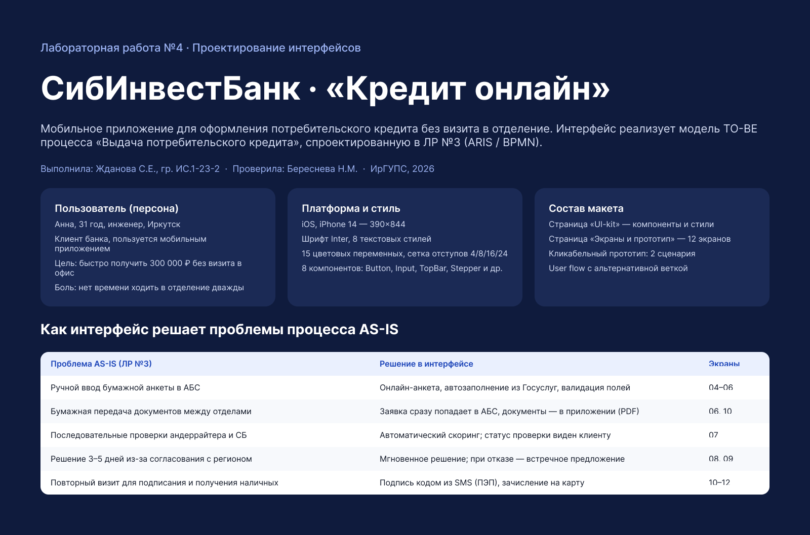
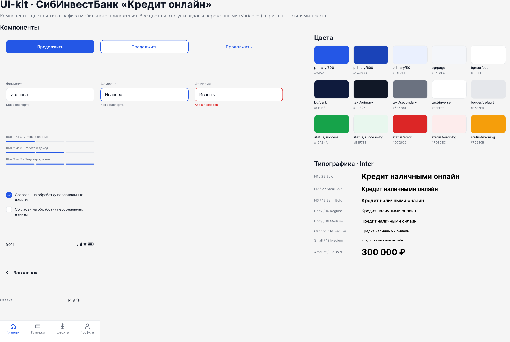
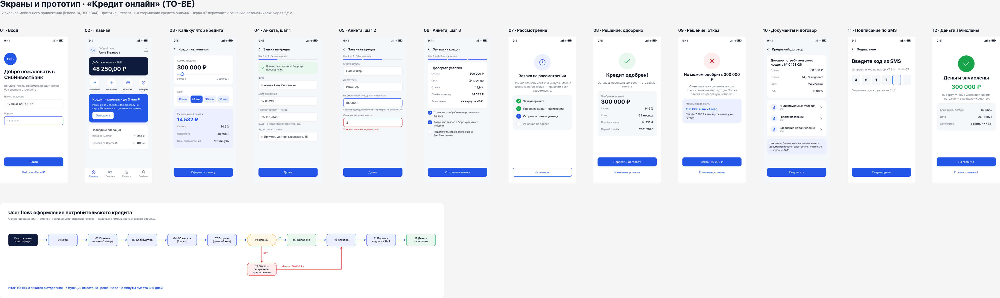
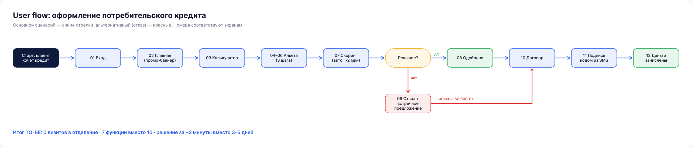

# Макет интерфейса «Кредит онлайн» — релиз design-v1.0

Мобильное приложение СибИнвестБанка (название условное) для оформления потребительского кредита без визита в отделение.
Интерфейс реализует модель TO-BE процесса «Выдача потребительского кредита» из лабораторной работы по ARIS / BPMN.

- **Макет в Figma:** https://www.figma.com/design/uXYDqLIi2tV3PsknZ7M1Rf
- **Кликабельный прототип:** https://www.figma.com/proto/uXYDqLIi2tV3PsknZ7M1Rf?node-id=3-2&starting-point-node-id=3%3A2

## Состав макета

| Страница Figma | Содержимое |
|---|---|
| Обложка | Тема, персона пользователя, таблица «проблема AS-IS → решение в интерфейсе» |
| UI-kit | 8 компонентов (Button, Input, Stepper, Checkbox, TopBar, StatusBar, ListRow, TabBar), 15 цветовых переменных, 10 переменных отступов и скруглений, 8 текстовых стилей (Inter) |
| Экраны и прототип | 12 экранов iPhone 14 (390×844), прототип из 2 сценариев, User flow |

## Экраны

| № | Экран | Назначение |
|---|---|---|
| 01 | Вход | Авторизация по телефону и паролю / Face ID |
| 02 | Главная | Баланс карты, быстрые действия, промо-баннер кредита |
| 03 | Калькулятор | Выбор суммы и срока, расчёт платежа (300 000 ₽, 24 мес, 14 532 ₽) |
| 04 | Анкета, шаг 1 | Личные данные, автозаполнение из Госуслуг |
| 05 | Анкета, шаг 2 | Работа и доход, пример валидации поля |
| 06 | Анкета, шаг 3 | Проверка условий и согласия |
| 07 | Рассмотрение | Статус автоматического скоринга |
| 08 | Одобрено | Одобренные условия кредита |
| 09 | Отказ | Отказ со встречным предложением (150 000 ₽) |
| 10 | Договор | Условия и документы (PDF) |
| 11 | Подписание | Простая электронная подпись кодом из SMS |
| 12 | Деньги зачислены | Итог и ближайший платёж |

## Изображения

